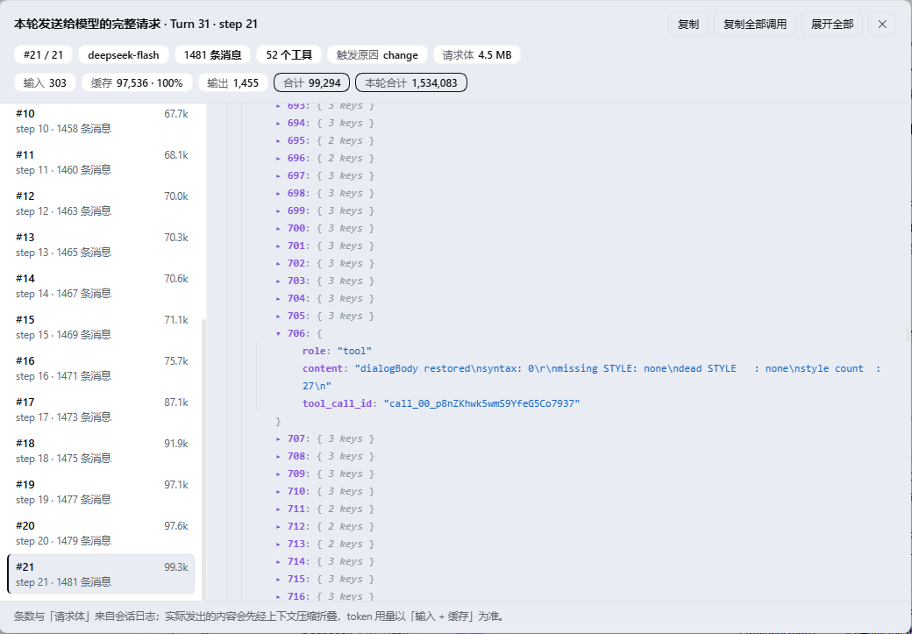

# dsh-payload

在 DeepSeek Harness（DSH）里，查看**每一次模型调用真实发出的完整请求**。

每条 assistant 回复下方的操作行里（和「复制」「好的回答」同一排）多一个 `{ }` 图标按钮，鼠标移上去浮出「查看请求 JSON」，点开是一个弹框，显示**产生这条回复的那一次调用**实际发给模型的 `model`、调用参数、`messages` 和 `tools`，以及这次调用的 token 拆解；弹框底部再按来源拆开这份上下文，回答「这些消息都是哪来的、哪一类在涨」。弹框里 **`messages` 默认只展开本轮新产生的消息**，更早的历史折叠成一行，需要时再展开。



截图来自一次**单轮 21 次模型调用**的真实会话：左侧逐行给出 `#k`、该次 token 和 `step n · m 条消息`（第 21 次是 1481 条消息、4.5 MB 请求体），右侧是选中那次的请求 JSON，`role: "tool"` 的那条就是某次工具结果被原样回传给模型的样子。

## 功能

- **精确到某一条回复**：每条 assistant 消息的按钮都指向产生它的那次调用，而不是「这一轮的最后一次」。
- **按调用分组**：一个 step 就是一次调用，一次调用一份快照。调用次数不多时用 `#1 #2 #3…` 标签页切换；超过 12 次自动换成**左侧 step 列表**（每行仍带 `#k`、token、`step n · m 条消息`），右侧 JSON 占满剩余宽度。
- **可折叠 JSON**：对象/数组默认折叠、标量直接展示，每个节点都能单独展开或收起，另有「全部展开 / 全部收起」；长字符串截断显示，复制时仍是原值。
- **历史与本轮分开**：`messages` 里本轮（这条回复所属的 Turn）新产生的消息默认展开、靠一条品牌色竖线标出，更早的历史合并成 `历史消息 (n)` 一行折叠起来，点一下就能展开；数组标题上同时给出 `本轮 n` / `历史 n` 两个计数。折叠只是显示层，下标仍是数组里的真实下标，复制出来的 JSON 一字不差。
- **token 用量**：顶部三层信息，第二行是调用元信息（`#k/N`、model、消息条数、工具数、触发原因），第三行是 token 拆解（输入 / 缓存与命中率 / 输出 / 合计 / 本轮合计），全部来自 provider 上报的真实数值。
- **相邻调用 diff**：同一轮里第 2 次及以后的调用，弹框会多一行「相比上一次调用」——`+n` 列出这次新增的消息，每条一行：`+下标`、角色、以及**这条消息在做什么**的摘要。摘要不是截断原文，而是按类型提取：
  - `assistant` 的工具调用 → `pwsh · cd E:\…`、`read · client.js`、`edit · client.js`（工具名 + 最有信息量的那个参数，优先取 `command` / `file_path` / `pattern` 等）；一次调用多个工具就是 `3 个工具: read, edit, pwsh`
  - `tool` 结果 → 结果正文的前 160 字（成功/失败的区别往往在句尾）
  - `user` → 用户原话，先剥掉 `Time sampled while preparing…` 这类本脚手架注进去的样板前缀

  每行前面有 `▸`，点开就是**这条消息本身的完整 JSON**（和右侧大 JSON 共用同一个可折叠树），所以「摘要不够全」的时候一键就能看到原文。上一版只取 `content` 平铺后的前 96 字，导致所有工具调用行都以 `{"type":"tool-call","id":"call_00_avGl…` 开头、真正有用的部分全被截掉——158 条新增里有 130 条是这种情况。

  列表高度按内容的 40vh 封顶（原先是 132px，只放得下 6 行）。另外单独标出 `-n`（有消息消失，通常意味着发生了什么压缩）、「原地改写」和「参数变化」（换了 model 或采样参数）。一轮的第一次调用直接写「本轮第一次调用，没有可比较的上一次」。
- **上下文来源占比**：弹框底部把这次请求的 `messages` 按来源分成五类并给出条数与占比——你的输入、harness 自动注入（时间上下文、运行时上下文、技能目录、系统提示、后台任务回报…）、模型回复、工具往返。图例默认只有一行，点某一类才展开它由哪些小类组成（例如「自动注入 41」拆成「时间上下文 33 · 运行时上下文 7 · 技能目录 1」）；旁边标出「本轮新增」占多少，用来回答「上下文为什么涨这么快」。占比按**消息字节**算，不是 token。
- **本轮时间线**：一轮里有多次调用时，头部多一条时间线——一步一段，宽度按该步实际消耗的 token 算（输入 + 缓存 + 输出），点哪段就切到哪次调用，一眼看出这轮的钱花在哪几步；右端是这一轮的总 token。它和下方的 `#1 #2 #3` 标签页 / 左侧 step 列表**分工不重复**：标签页和列表回答「选第几次调用」（并给出条数、step 号），时间线只回答「占比」，所以不再重复印一遍 `#k · step n · token`。工具数、往返数、工具名也都不印——前两个每步恒为「1」，工具名描述的是这一步**产出**的调用，而这套编号指向**请求快照**，混在一起容易误读成「这次请求里有那个调用」。
- **JSON ↔ 对话互链**：`messages` 里每条消息的行上，鼠标移过去会出现一个 `对话 ↗` 小标签，点它关掉弹框、并把对话滚动到**这条消息自己的气泡**（精确到 `data-chat-node-key`；气泡在折叠的轮次里没挂载时，退回滚到该轮 `data-chat-turn`）。反方向同理：从某条回复的按钮打开弹框时，那份 JSON 会直接停在**这条回复对应的那一行**并加一圈高亮，不用自己去几百条消息里找。
- **复制**：复制当前那次调用，或「复制全部调用」导出成请求数组。
- **长文档导航**：JSON 面板右侧是常驻加宽的滚动条，可直接拖拽跳转（覆盖层滚动条太细、会自动淡出）；头部另有「↑ 顶部 / ↓ 末尾」按钮，切换调用或展开/收起后自动回到顶部。
- `Esc` 或点击遮罩关闭；标签页/step 列表支持鼠标与 ↑/↓/Home/End。

## 安装

插件是一个 Cordis bundle（`cordis.patch.yml` + 一个纯客户端 `client.js`），装进 DSH profile 后刷新界面即可。

**方式一：从 GitHub 安装**（让 DSH 里的 agent 执行，或自己调 `plugin_manager` 的 `install_bundle`）：

```
git+https://github.com/shengpj/dsh-payload.git#<commit>
```

`<commit>` 用 40 位 SHA：`git ls-remote https://github.com/shengpj/dsh-payload.git refs/heads/main` 取当前值。

**方式二：走插件市场索引**。仓库里带了一份 `market/index.json`（DSH 插件市场 format 1）。启用 `plugin-market` 后把这个地址加成索引：

```
https://raw.githubusercontent.com/shengpj/dsh-payload/main/market/index.json
```

之后在 Discover 里搜 `dsh-payload` 就能一键安装——索引里的版本指向 commit-pinned 的 git 源，装到的就是仓库里对应的那一版。

发新版本时用 `node tools/build-market-index.mjs --commit <40 位 SHA> --version <新版本号>` 往索引里加一条（旧版本条目会保留）。

**方式三：本地目录**（改代码时更方便，`link:` 不需要重装）：

```
git clone https://github.com/shengpj/dsh-payload.git
# 然后用 link:<绝对路径> 安装这个目录
```

装好后在 profile 的 bundles 列表里能看到 `dsh-payload`，刷新界面（桌面端 `Ctrl+R`，改不动就退出重开），回复下方就出现图标。

## 使用

1. 找到某条 assistant 回复，把鼠标移到操作行的 `{ }` 上，气泡显示「查看请求 JSON」。
2. 点击，弹框打开并**直接停在产生这条回复的那次调用**上。
3. `messages` 默认只展开本轮新产生的消息：更早的历史收在 `历史消息 (n)` 这一行里，点开即可看到完整上下文；数组标题上的 `本轮 n` / `历史 n` 告诉你各有多少条。
4. 若这条回复所在的 Turn 调用了很多次，用标签页或左侧列表切换，看每一次各自发了什么。
5. 「复制」拿走当前这份请求，「复制全部调用」拿走整轮所有请求组成的数组。

## 数据来源

不重发请求、不新增服务端接口，完全离线重建：数据全部来自 Client 已经持有的会话日志。

| 需要的字段 | 日志来源 |
| --- | --- |
| 调用边界（每次调用一条） | `step/start` + `step/end` 的 `{turn, step}` |
| `model`、`provider` | 该 step 的 `assistant/message.data.message.source`（响应里回写的真实来源），缺失时退回 `request/header` 的 `header.config` |
| temperature / maxTokens 等调用参数 | `request/header` 的 `header.config`（EpochHeader / LlmCallConfig），稀疏，需向前继承 |
| `tools` | `request/header` 的 `header.tools`（ToolSchema[]），同样需向前继承 |
| `messages` | 该 step 首个响应事件之前的所有 surface 事件：`system/message`、`developer/message`、`user/message`、`assistant/message`、`tool/result`；`tool/call` 会挂到前一条 assistant 消息的 `tool_calls` 上 |
| 本轮 / 历史的切分 | 这条回复所属 Turn 的 `turn/start.seq`：seq 不小于它的消息算本轮（用户消息、本轮注入的上下文、这一轮已产生的 assistant 与工具结果），更早的是历史 |
| token 用量 | 该 step 的 `assistant/message.data.usage`（provider 上报的真实值，不是估算） |

`request/header` 只在调用配置发生变化时才写一条（`reason` 为 `initial` / `change` / `resume` / `series`），不是每次调用都有——所以分组锚点用 `step/start`，配置从不超过该 step 的最近一条 header 继承。

## token 口径

`assistant/message.data.usage` 的字段：

| 字段 | 含义 |
| --- | --- |
| `inputTokens` | 本次实际发出的 prompt tokens 中**未命中缓存**的部分 |
| `cacheReadTokens` | 命中 prompt cache 的 tokens |
| `outputTokens` | 模型生成的 tokens |
| `totalTokens` | provider 的合计，等于 `inputTokens + cacheReadTokens + outputTokens` |

命中率按 `cacheReadTokens / (inputTokens + cacheReadTokens)` 计算。标签页/step 行上是紧凑值（`12.4k`），弹框头部是该次调用的精确拆解，多调用时另给「本轮合计」。

三个容易混的量：

| 指标 | 真实含义 |
| --- | --- |
| 「输入」chip | **未命中前缀缓存**的 prompt tokens，只是 prompt 的一部分，**不是 JSON 大小** |
| 「缓存」chip | 命中 prompt cache 的部分；输入 + 缓存才是完整 prompt |
| 「N 条消息」「请求体 X MB」 | 这次请求携带的**消息条数**（不是 token，也不是字数）与重建 JSON 的字节数；字节 ≠ token（中文约 1 token ≈ 1–2 字节） |

为什么相邻两次调用经常只差 2 条：一步的产物正好是「一条 assistant 消息（它的 tool_calls）+ 一条对应的 tool 结果」，所以下一步的请求比上一步多 2 条；某一步没调用工具（直接结束）就不增长，连续调多次工具则一次增长多条。

实测差异：某次调用 `input 1009 / cache 80,640 / output 1,425 / total 83,074`，而日志重建出 1078 条消息、3.70 MB、约 754 k tokens——provider 只按 81,649 prompt tokens 计费，差 9.2 倍。原因是请求发出前会先经**上下文压缩**把旧区间折叠成摘要，日志保留原文、模型只读摘要，所以条数与字节远大于计费 tokens。因此 token 一律以 `assistant/message.data.usage` 为准，条数/字节只作「这份快照有多大」的参考；每个 chip 都挂了 `title` 说明，日志条数超过 200 时弹框底部另补一行同样口径的提示。

## 限制

- 只支持 DSH 的图形界面客户端（纯客户端插件，没有 Host 半边的服务注册）；TUI/CLI 下没有入口。
- 首次打开某个 Turn 时需要把会话窗口往前翻完（`loadOlder()`），几十次调用、上万条事件的大会话里会有可观的首开耗时；同一 Turn 的结果会缓存，再开很快。
- provider 没上报 `usage` 的调用会显示「未记录到用量」，其余部分照常展示。
- 已定稿的 assistant 消息才有操作行，正在流式输出的那条没有。

在 DSH `0.2.1-rc.3` 桌面端上开发并验证。

## 开发

```
index.js                     Host 半边（空 apply，只为让 bundle 有个 host 入口）
client.js                    全部实现：注册 + 重建 + 弹框 + 折叠树
cordis.patch.yml             装进 profile 时插入的条目
tools/verify-against-session.cjs   无浏览器验证数据管线，并对账每条消息→调用的映射与本轮/历史切分
tools/render-smoke.cjs             无浏览器渲染冒烟（stub React），跑 12 个场景（含错误边界）
tools/audit-keys.cjs               静态检查 STYLE/TEXT 键是否还有引用
tools/asar-extract.cjs             从 app.asar 抽单个文件（查官方样式/类型用）
tools/build-market-index.mjs       把某个 commit 写进市场索引（发版用）
docs/notes.md                      实现细节与踩坑记录
market/index.json                  插件市场索引（format 1）
```

验证（Node 18+，不需要浏览器）：

```bash
node tools/verify-against-session.cjs             # 数据：自动取最新的会话日志
node tools/verify-against-session.cjs <log.zstd>  # 或指定日志文件
node tools/render-smoke.cjs                       # 渲染：12 个场景
node tools/audit-keys.cjs                         # 静态：死键必须为 0
```

`verify-against-session.cjs` 除了对账每个 Turn 的调用次数与 token 总量，还会检查四组不变量：本轮/历史切分（`historyEnd` 落在 `0..messages` 之间、随 step 前进只增不减、且不少于上一轮最后一次调用已携带的消息数）、来源分类（每条消息恰好归类一次，且各类之和等于 `messages.length`）、相邻调用 diff（首调用没有 diff；其余调用满足 `prefix + added = messages`，`removed > 0` 时必须同时标记为改写），以及 step 记录区间（每个调用都满足 `startSeq ≤ endSeq`，且各 step 的区间互不重叠——时间线就是靠这个区间算出每步的 token），和跨链（`meta.messageLinks` 与 `request.messages` 等长，assistant 消息映射到 `14:assistant-step<turn>:<step>`、工具结果映射到 `9:tool-call<callId>`、其余映射到 `13:input-message<id>`，与对话端 `data-chat-node-key` 的公式一致）。逐 Turn 重建再释放，避免把整份会话的所有 prompt 同时留在内存里。

数据管线的核心是五步：定位消息所属 Turn → 翻完窗口 → 逐个 `step/start` 切分 → 每个切点折叠出 `messages` 并继承最近一条 `request/header` → 按 `meta.step` 选中目标调用。踩过的坑（slot 组件里不能用注入式 hook、`request/header` 稀疏、空 `content: []` 是增量标记、`listTokens` 不是全量 token 表等）都记在 [docs/notes.md](docs/notes.md)。

弹框外面套了一圈错误边界：万一某次渲染抛错，弹出的是「读取失败：<原始信息>」而不是整页白屏，控制台还会留一行 `[dsh-payload] render failed`。这样下次再出问题，报错里就有能直接定位的那句话。

## License

MIT
